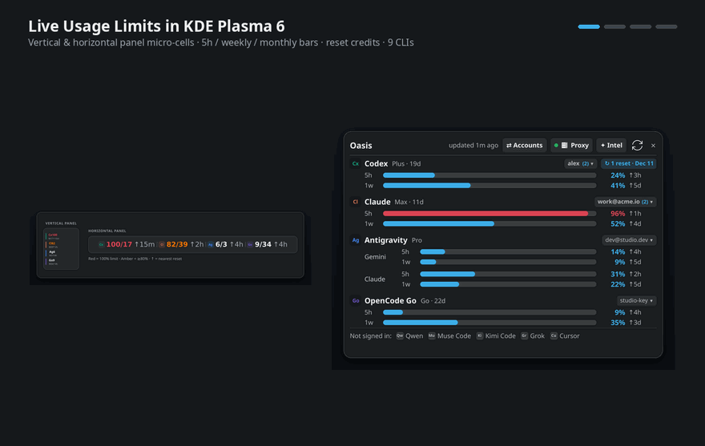
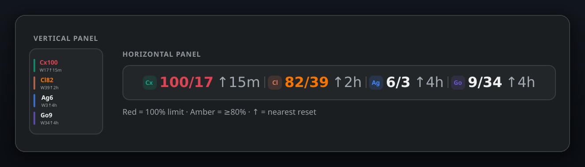
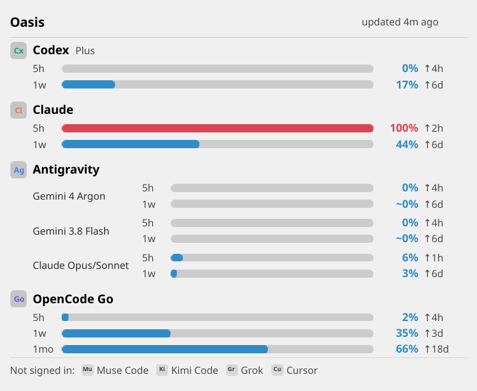
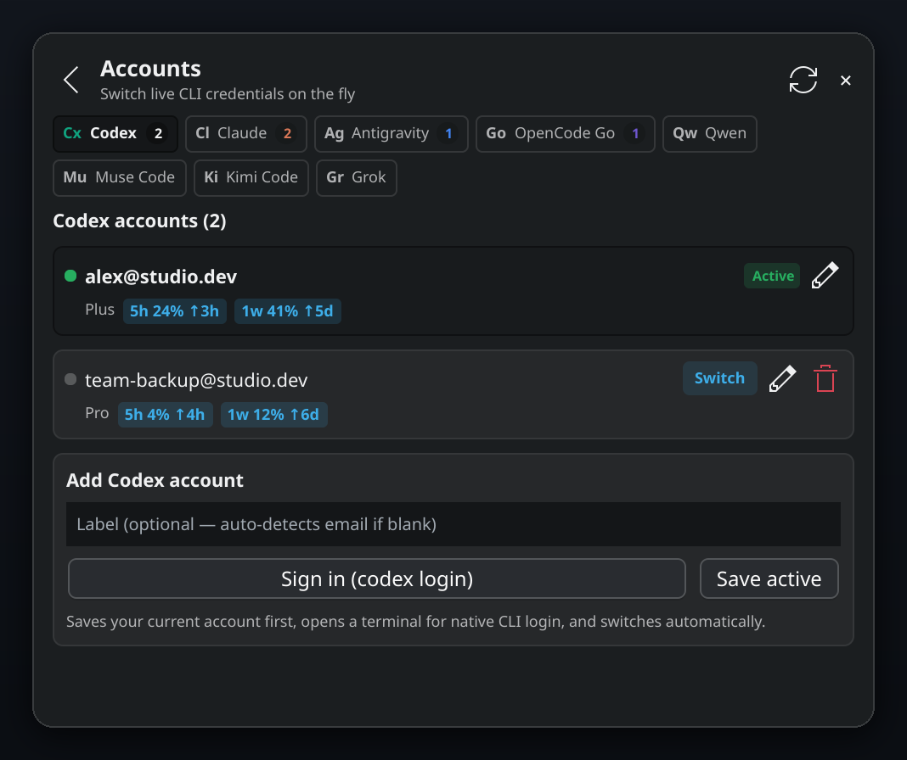
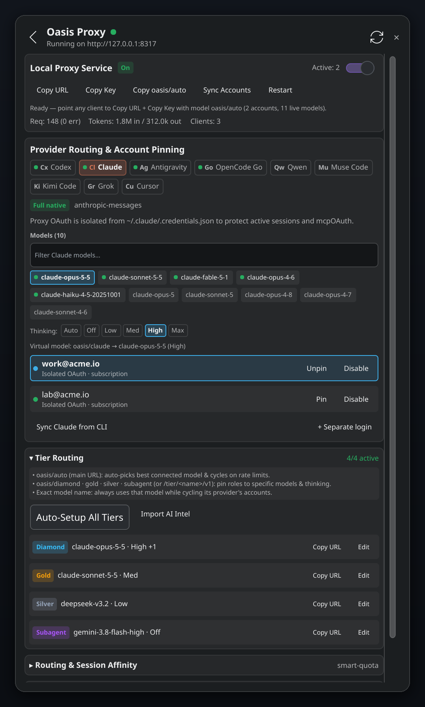
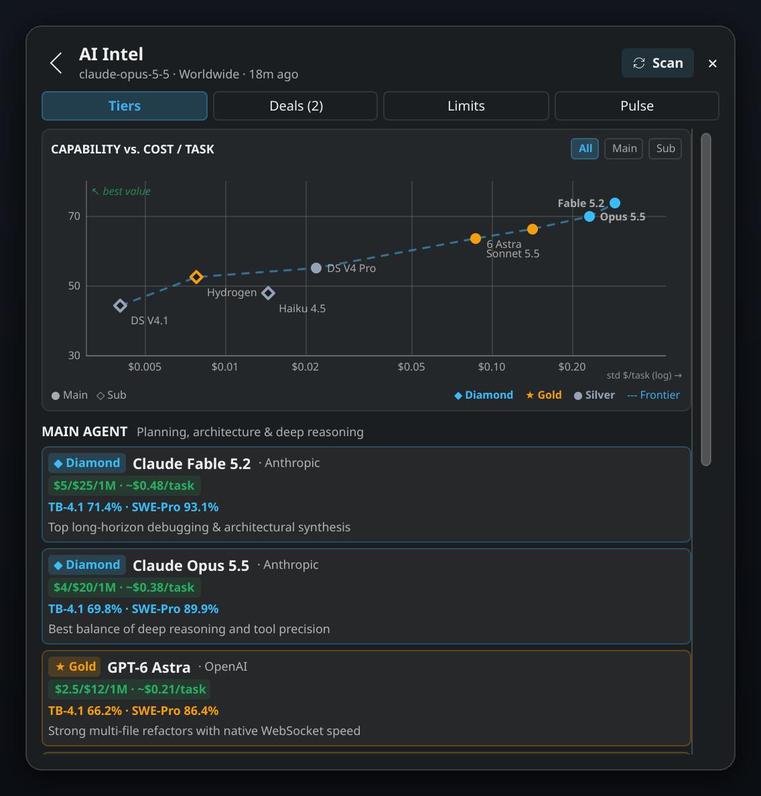

# Oasis

[](https://github.com/dralkh/oasis/actions/workflows/ci.yml)
[](LICENSE)

A KDE Plasma 6 panel widget for keeping an eye on AI coding CLI subscription limits without opening a browser tab for every provider.

It reads the local credentials your CLIs already store, shows 5-hour / weekly / monthly usage and reset times in your panel, lets you switch between saved accounts, and includes an optional local proxy (`127.0.0.1:8317`) if you want your tools to cycle across accounts and models automatically.

Supported providers: **Codex**, **Claude Code**, **Antigravity (Gemini & Claude)**, **OpenCode Go**, **Qwen**, **Muse Code**, **Kimi Code**, **Grok**, and **Cursor**.

<p align="center">
  
</p>

<details>
<summary>Static screenshots (panel, popup, accounts, proxy, intel)</summary>

<p align="center">
  
</p>

| Usage popup | Multi-account manager (`⇄ Accounts`) |
| :---: | :---: |
|  |  |

| Local proxy (`Proxy`) | AI Intel (`✦ Intel`) |
| :---: | :---: |
|  |  |

</details>

---

## Install

Requires **KDE Plasma 6** and **Python 3** (stdlib only). Optional: `secret-tool` (`libsecret`) for keyring-backed CLIs (Antigravity, Cursor, Muse), `notify-send` for 100% limit alerts, and `wl-copy` or `xclip` for clipboard buttons.

### From GitHub Releases (`.plasmoid`)

Download the latest `.plasmoid` from [Releases](https://github.com/dralkh/oasis/releases/latest):

```sh
kpackagetool6 -t Plasma/Applet -i oasis-1.5.0.plasmoid
# or upgrade:
kpackagetool6 -t Plasma/Applet -u oasis-1.5.0.plasmoid
```

### From source

```sh
git clone https://github.com/dralkh/oasis.git
cd oasis
./install.sh          # builds and installs the widget + launcher entry (no sudo, no pip)
./add-to-panel.sh     # optional: adds it to the panel with your system tray
```

### KDE Store / Arch Linux (AUR)

- **KDE Store:** Right-click panel → **Add Widgets…** → **Get New…** → search **Oasis**.
- **AUR:** `packaging/aur/PKGBUILD` (`plasma6-applets-oasis`) is included in the repo.

### Uninstall

```sh
./uninstall.sh
rm -rf ~/.cache/ai-limits
```

---

## What it does

### 1. Panel cells and popup

In a vertical panel, each provider takes two short lines (or a single chip in a horizontal panel):

```text
Cx100   Codex at 100% of its 5h window (red)
W17↑1h  Weekly at 17%, nearest reset in 1h
Cl28
W28↑6d
```

Click the widget to see full usage bars, reset timestamps (hover a bar for the exact local time), remaining billing days where exposed, and available reset credits (`↻ 1 reset`). Signed-out providers stay collapsed into one footer line.

When any window crosses 100%, Oasis sends one desktop notification via `notify-send` and re-arms once that window resets.

### 2. Switch CLI accounts (`⇄ Accounts`)

Click an account pill on a provider row (or **⇄ Accounts** in the header) to see live usage previews for your other saved logins and switch immediately.

- **Sign in:** snapshots your current CLI login first so you don't lose it, runs the native CLI login (`codex login`, `claude auth login`, `agy`, etc.) in a terminal, saves the new account, and restores the previous one if you cancel.
- **API keys:** OpenCode Go, Qwen, and Kimi can store API keys via a password prompt (`kdialog` or hidden terminal input — keys are never passed in argv).
- **Safe handoff:** before switching away from an active account, Oasis writes any rotated CLI tokens back to its local vault (`~/.config/oasis/accounts`, `0700`/`0600`).

### 3. Local proxy (`Proxy`, optional)

Off by default (zero background processes or RAM). Toggle **Oasis Proxy** on when you want a single local OpenAI/Anthropic/Gemini-compatible endpoint at `http://127.0.0.1:8317` backed by your existing CLI subscriptions.

- **Auto-syncs existing CLI logins:** turning the proxy on imports your already signed-in Codex, Claude, Antigravity, OpenCode Go, Qwen, Kimi, Grok, and Muse accounts into `~/.config/oasis/proxy/auths/` (`0600`) without breaking your CLIs.
- **Use `oasis/auto` if you don't want to configure anything:** point a client at `http://127.0.0.1:8317/v1`, paste the generated key (**Copy Key**), and set model to `oasis/auto` (or `oasis`). It routes to the highest-ranked available model and automatically rotates away from cooling or rate-limited accounts.
- **Optional tiers:** expand **Tier Routing** if you want fixed slots (`oasis/diamond`, `oasis/gold`, `oasis/silver`, `oasis/subagent`) or per-tier base URLs (`/tier/diamond/v1`, etc.) with thinking-effort presets.

Example client configs:

```sh
# Claude Code
export ANTHROPIC_BASE_URL=http://127.0.0.1:8317
export ANTHROPIC_AUTH_TOKEN="<paste key from Copy Key>"
claude
```

```python
# OpenAI Python SDK
from openai import OpenAI

client = OpenAI(base_url="http://127.0.0.1:8317/v1", api_key="<paste key from Copy Key>")
resp = client.chat.completions.create(
    model="oasis/auto",
    messages=[{"role": "user", "content": "Hello"}],
)
```

### 4. AI Intel (`✦ Intel`, optional)

Runs on demand (never in the background) using whichever CLI agent you already have installed (`Claude`, `Codex`, `OpenCode`, `Gemini`, `Pi`, `Qwen`, or `Kimi`) to build a cached summary of model tiers, deals, and limit projections. Pick **Auto** or choose a specific CLI right inside the modal.

---

## Credential sources

Everything below is read locally; background polling (`ai_limits.py`) only writes to `~/.cache/ai-limits/` and (when Claude's 8h access token expires) refreshes `~/.claude/.credentials.json` under Claude Code's own lock files.

| Provider | Where Oasis reads credentials | Windows |
|---|---|---|
| Codex | `~/.codex/auth.json` (or OpenCode `openai` OAuth) | 5h, weekly |
| Claude | `~/.claude/.credentials.json` | 5h, weekly, Opus/Sonnet weekly |
| Antigravity | Secret Service (`gemini` / `antigravity`) | 5h + weekly (Gemini & Claude) |
| OpenCode Go | `~/.local/share/opencode/opencode.db` (or `auth.json`) | 5h, weekly, monthly |
| Qwen | `~/.qwen/oauth_creds.json`, `QWEN_CODING_API_KEY`, `DASHSCOPE_API_KEY`, or OpenCode DB | rate limits / status |
| Muse Code | `~/.config/muse/auth.json` or Secret Service (`ai.meta.dev.credentials/meta`) | 5h, weekly |
| Kimi Code | `KIMI_CODE_API_KEY`, `~/.codexbar/config.json`, or `~/.kimi-code/credentials/kimi-code.json` | 5h, weekly, monthly |
| Grok | `~/.grok/auth.json` | weekly |
| Cursor | `~/.config/Cursor/User/globalStorage/state.vscdb` or Secret Service | billing cycle |

---

## Inspecting and auditing the code

The widget helpers are plain stdlib Python 3 (`package/contents/code/`), the UI is plain QML (`package/contents/ui/`), and the optional local proxy engine is built from `proxy/` (Rust).

- No telemetry, no analytics, no auto-updater, no `pip install`.
- Every HTTP request in `ai_limits.py` is checked against `ALLOWED_HOSTS`, redirects are disabled, and environment proxies are ignored.
- Proxy mode binds to `127.0.0.1` only with separate 256-bit client and management keys (`0600`).

Quick commands to inspect what Oasis sees and connects to:

```sh
# Credential paths found on this machine (presence only, never prints values)
python3 package/contents/code/ai_limits.py selftest

# Accounts detected across CLIs (metadata only)
python3 package/contents/code/oasis_accounts.py list --pretty

# Exact JSON document fed to the Plasma widget
python3 package/contents/code/ai_limits.py fetch --pretty

# Verify outbound connections directly
strace -f -e trace=connect python3 package/contents/code/ai_limits.py fetch
```

More details if you're reviewing the internals:
- [SECURITY.md](SECURITY.md) — data flows and threat model
- [docs/SECURITY_AND_CREDENTIALS.md](docs/SECURITY_AND_CREDENTIALS.md) — proxy credential isolation and locking
- [docs/PROVIDER_MATRIX.md](docs/PROVIDER_MATRIX.md) — provider protocol support

---

## Notes & caveats

- **No resident daemon by default:** in direct mode, `ai_limits.py` runs every 5 minutes (~1.2 s wall time, mostly network wait), caches to `~/.cache/ai-limits/last.json`, and exits. Proxy mode runs `oasis-proxy` (~11 MiB RSS) only when toggled on.
- **Codex / Grok / Cursor tokens:** because their refresh tokens rotate, background polling opens them read-only and shows `expired` until you run the real CLI once.
- **Claude 429s:** if Anthropic rate-limits the usage endpoint, Oasis keeps the last good reading visible with a `stale` badge.
- **Vertical panel height:** Plasma caches applet size hints, so vertical mode reserves a fixed number of slots (default 4). Raise **Vertical panel slots** in widget settings if you track more than 4 providers at once.

## Acknowledgments

- [CLIProxyAPI-Rust](https://github.com/IuCC123/CLIProxyAPI-Rust) *(Unlicense)* — upstream Rust inference proxy adapted inside `proxy/`.

## Disclaimer & License

Oasis is an independent, unofficial project and is not affiliated with or endorsed by OpenAI, Anthropic, Google, Cursor, xAI, Meta, Moonshot, or Alibaba. If you enable the optional local proxy mode, you are responsible for complying with each provider's Terms of Service.

MIT. See [LICENSE](LICENSE).
